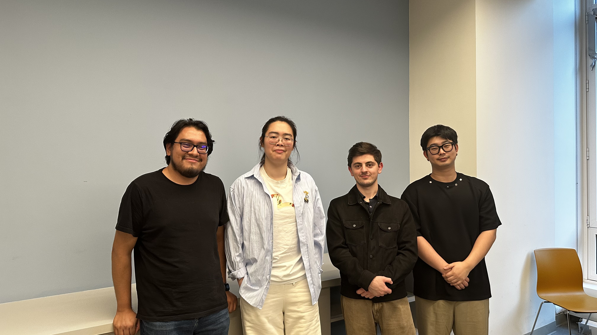

# TEAM 8

## App name: CampusCycle

## Team members

Dennis Fung

Jerry Huang

Amir Abdullozoda

Ivan Trujillo-Armijo

## App description
A Campus-only second-hand marketplace

## Idea Proposal
[Idea Proposal](https://docs.google.com/document/d/1jqzHU9Lsjm9iMQ0DHw1OyCnxMYDaPBT3/edit?usp=sharing&ouid=100011191681903624157&rtpof=true&sd=true)

## Calendar
[Calendar](https://calendar.google.com/calendar/u/0?cid=aXZoMmU3NjhzMjRkdGlxZWYwcXZvbzhxcjBAZ3JvdXAuY2FsZW5kYXIuZ29vZ2xlLmNvbQ)

## Product Backlog
[Requirements Discovery](https://docs.google.com/document/d/1dOXgGm7NkfFyu0tFLkRq-aQd3wVGMQ9f/edit?usp=sharing&ouid=107304274763976758367&rtpof=true&sd=true)

[Backlog Validation](https://drive.google.com/file/d/1j-BN4J23dKzQ67lnYvfzY9wk2DALTnkO/view?usp=drive_link)

[Product Backlog](https://docs.google.com/spreadsheets/d/1T9ogkZ1NKx7lBxWzRkc2HEQDc-TxDZfaZLw8lTeUUAU/edit?usp=sharing)

## Architecture & Design
[Architecture & Design]()

[Design Figma](https://www.figma.com/design/5XFSUXQwSKHq3wnEbXdl0N/Untitled?t=Emnyqv6e3iYOTNSN-1)

## Process

### Sprint 1

* [Sprint planning]()
* [Scrums]()
* [Sprint demo video]()
* [Sprint retrospective]()

### Sprint 2

* [Sprint planning]()
* [Scrums]()
* [Sprint demo video]()
* [Sprint retrospective]()

### Sprint 3

* [Sprint planning]()
* [Scrums]()
* [Sprint demo video]()
* [Sprint retrospective]()

## Tools & APIs

## Final delivery

* [Final presentation]()
* [Poster]()
* [Process description]()

